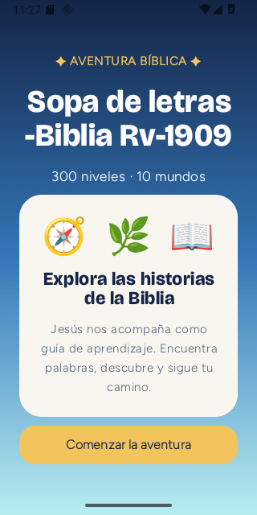
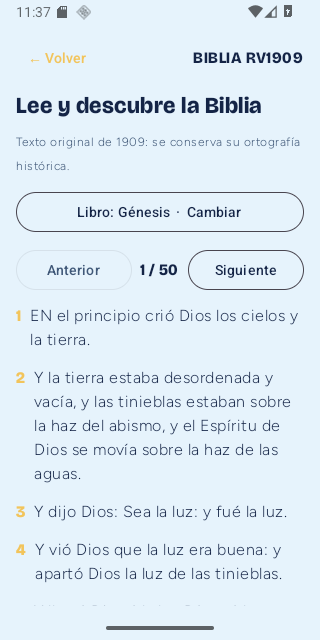
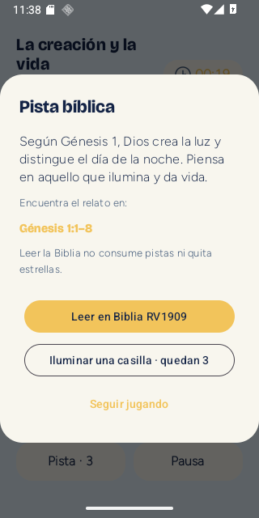
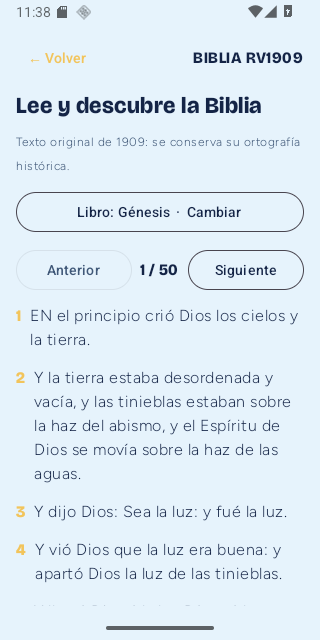
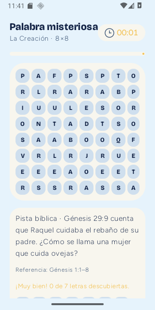
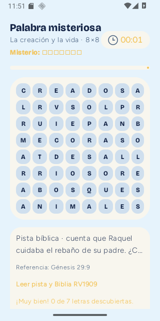
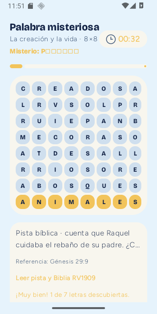

# QA real Android RV1909 RC2

Android API36 320x640. Prueba posterior: el misterio muestra la referencia Génesis 29:9; al encontrar ANIMALES aparece P□□□□□□ (1 de 7), Android API 36 320x640. La captura antigua se conserva solo por comparación.

