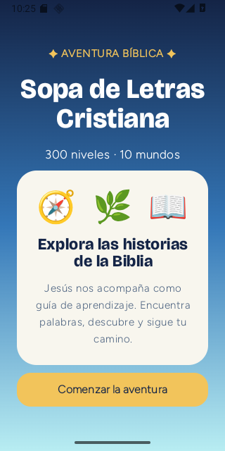
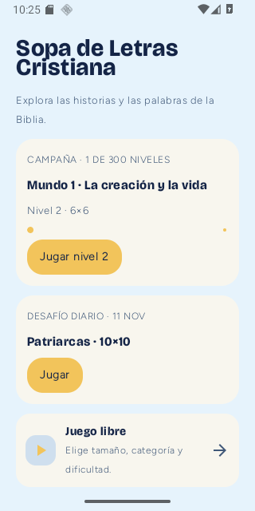
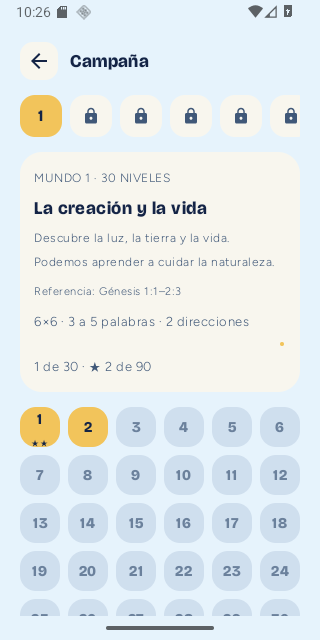
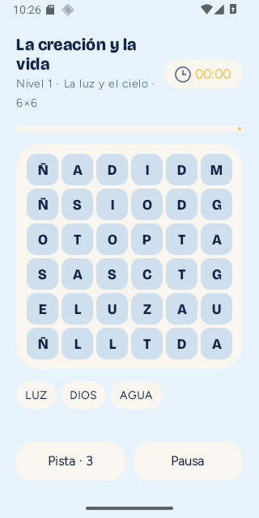
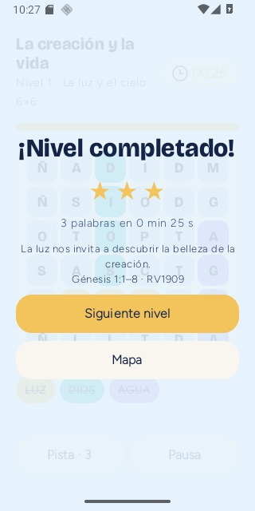
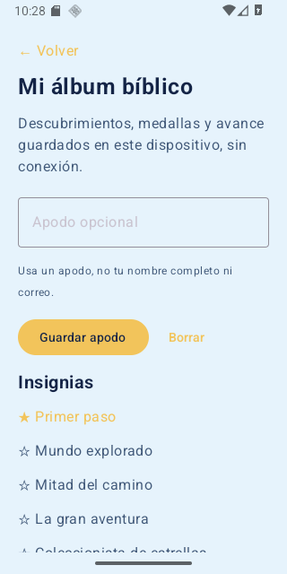
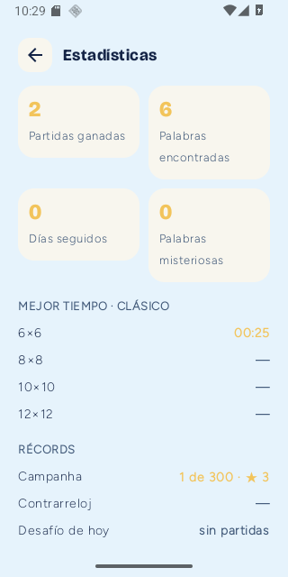
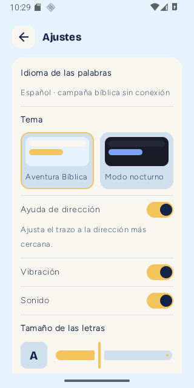

# Revisión visual consolidada · Sopa de Letras Cristiana · 11-11-2026

**Estado:** paquete de **ocho capturas reales** de Android API 36, resolución **320×640 px**, APK debug versión 1.0.6-candidate-dev. Esta es la revisión visual consolidada para el **único punto de control humano** previsto por Workflow V3. Las capturas no implican aún aprobación visual.

**APK privada de prueba:** [Borrador de lanzamiento en GitHub (visible al propietario del repositorio)](https://github.com/cmiloarevalo-hash/Sopa-de-Letras-Cristiana/releases/tag/untagged-310ddb2cbe0e0c88e091). El archivo adjunto `Sopa-de-Letras-Cristiana-v1.0.6-rc1-debug.apk` es una candidata **NO PUBLICADA**, no la APK definitiva.

## 1. Portada

## 2. Inicio y continuar progreso

## 3. Campaña, mundo 1, niveles desplazables

## 4. Tablero de juego, nivel 1

## 5. Victoria del nivel 1 y mensaje educativo

## 6. Álbum bíblico

## 7. Estadísticas

## 8. Ajustes y accesibilidad

## QA efectivamente ejecutado
- **Compilación:** `gradlew :app:testDebugUnitTest :app:assembleDebug --offline` → **BUILD SUCCESSFUL**.
- **JVM:** **86/86** tests PASS, incluidos 300 niveles fijos de vocabulario y 10 misterios, corrección de palíndromos.
- **Emulador real:** `adb install -r` → **Success**; apertura de `app.sopadeletras.cristiana.debug/app.sopadeletras.MainActivity` → PASS.
- **Flujo táctil probado:** portada → inicio → campaña → nivel 1; seleccionar LUZ, DIOS y AGUA → victoria; dos sesiones de juego completadas → estrellas y estadísticas persistentes → nivel 2 desbloqueado; app cerrada/reabierta conservó el estado.
- **Fallo detectado y corregido:** mapa de campaña dejaba fuera de la vista la grilla de niveles en 320×640; sustituido por cinco filas desplazables, probado visualmente.
- **Correcciones de experiencia:** guías de mundos más sencillas; rango real de palabras en mapa; contraste del mensaje de victoria; textos portugueses secundarios traducidos; identidad Android y versión 1.0.6.
- **APK**: 13.939.437 bytes; SHA-256 `91D72565AA8252DD2F62BCDF22348B68795885209EF1A3F367CDA3F8FB081016`. Versión 1.0.6-candidate-dev, versionCode 25, Android 8.0+ (minSdk 26), targetSdk36, firma de depuración v2 verificada.
- **Código compilado exacto:** `c5558fff6563343a6d4452db8c20cdf8a39e738a` (PR #16 con commits adicionales únicamente de capturas y documentación).

## Pendientes y fronteras
- La **revisión humana visual consolidada** sigue **PENDIENTE**; presentar las ocho imágenes juntas y recibir una sola evaluación global.
- **Google A6:** por orden del Humano, es la **última integración** y no está incluida en la APK candidata. Sin credenciales/configuración OAuth real no afirmar recuperación de progreso en otra cuenta.
- **No se ha verificado táctilmente** el conjunto completo de 300 niveles ni la modalidad misteriosa en el emulador; existen pruebas unitarias y generativas en Kotlin, no sustituir con ellas todos los casos de QA visual. Una auditoría independiente de código/pruebas sigue pendiente.
- Esta APK es **debug** firmada con clave de depuración. Para distribución definitiva, gestionar firma de lanzamiento conservable por el propietario y su código de actualización, después de la aceptación visual y la integración Google.
- El emulador Android compartido del otro proyecto fue usado temporalmente **sin alterar datos de Lago-1**; restaurar su aplicación anterior después de esta QA.

**Decisión operativa:** el Supervisor puede seguir corrigiendo defectos reales y preparar la app sin esperar aprobaciones intermedias; **no declarará definitivos ni publicados** la UI, Google o el lanzamiento antes de la evidencia requerida.

## Variante release optimizada verificada en emulador

- Se ejecutó `gradlew :app:assembleRelease --no-daemon --console=plain` en Windows: **BUILD SUCCESSFUL** tras descargar una dependencia de Compose que no figuraba en la caché offline.
- Archivo generado: `app/build/outputs/apk/release/app-release.apk`, **2.509.150 bytes**, SHA256 **`40CD8A6DE0FFEA82A8FF9004476639B9BF40D73F767124D218CA3E0769A7D904`**.
- Identidad `app.sopadeletras.cristiana`, versionName `1.0.6`, versionCode `25`, minSdk26/targetSdk36, firma Android v2 verificada; **se compiló con clave de depuración por ausencia de credenciales de producción durante esa ejecución**, por lo que **NO es APK definitiva de distribución**.
- Instalación `adb install -r` → **Success**, apertura de Activity y tablero del nivel 1 en emulador 320×640 → **PASS**, sin fallo fatal en registros examinados.
- Se creó una **clave de firma de producción distinta** bajo directorio privado del computador autorizado, fuera de GitHub; la ejecución que necesita leer su contraseña local está pendiente de autorización del equipo. La clave y su contraseña deben ser respaldadas por el propietario; **jamás compartirlas en repositorio**.
- La revisión humana consolidada de estas ocho capturas sigue pendiente de confirmación.
