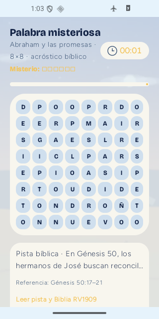
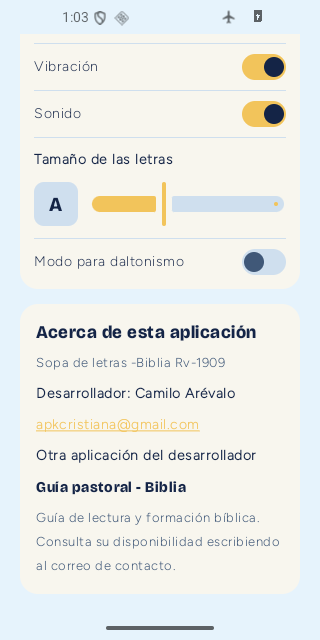

# QA Android · Misterio 8×8 y créditos · 12-11-2026

**Dispositivo:** emulador Android API 36, área de prueba 320×640.
**Compilación:** Sopa de letras -Biblia Rv-1909, versión 1.0.9 candidata debug (versionCode 28).

## Caso 1 · El tamaño seleccionado se conserva

1. Inicio → Palabra misteriosa.
2. Seleccionar **8×8** y la categoría **Abraham y las promesas**.
3. Desplazarse y pulsar Comenzar.
4. Resultado visual: **«Abraham y las promesas · 8×8 · acróstico bíblico»**. El tablero tiene 8 columnas y 8 filas; **no** cambia a 10×10.
5. Las 30 combinaciones (diez categorías por tamaños 6×6, 8×8, 10×10) se generaron realmente en el motor y superaron una prueba JVM, que también comprueba sus iniciales y la pista bíblica.

## Caso 2 · Información del autor

En Inicio → Ajustes → Acerca de esta aplicación se ven:
- Desarrollador: **Camilo Arévalo**.
- Contacto: **apkcristiana@gmail.com**, que abre el correo del dispositivo.
- Otra aplicación: **Guía pastoral - Biblia**, descrita como guía de lectura y formación bíblica.

## Pruebas y alcance

La ejecución de Gradle \`testDebugUnitTest assembleDebug\` terminó con **BUILD SUCCESSFUL: 95 pruebas, 0 fallos**. El validador editorial comprobó los 300 niveles, 2524 asociaciones palabra-pista y diez acrósticos. El APK de prueba se instaló sobre la identidad Android existente y las dos pantallas anteriores se comprobaban por jerarquía de accesibilidad y capturas reales.

**No afirmar:** APK de producción, aprobación editorial/visual humana completa, restauración Google en otra cuenta o disponibilidad pública de Guía pastoral - Biblia. No se modificaron los 300 tableros fijos de campaña, ni se añadieron capas de seguridad o complejidad.

